# Architecture

This document describes the current architecture of **osu-hitsound-editor**.

Its purpose is to provide a visual reference for how `.osu` data is parsed, how timing and hitsound values are resolved, and how the current logical representation is separated from the physical sample representation that osu! uses.

> The architecture will continue to evolve as the project grows. This document describes the current implementation, not a final design.

---

## Current Stage

Parsing, logical hitsound resolution, and the current physical sample-resolution boundary are complete. The project is in **Audio Infrastructure**.

Verified checkpoint (2026-10-14):

```text
669/669 automated tests passing (full suite)
```

The audio engine supports decoding, normalized mixing, timeline seek, rendered-position reporting, and relative source delays through `OffsetSampleProvider`. `Beatmap` enumerates chronological discrete hitsound events, and `TimedHitSoundPlaybackCursor` tracks selection progress. `HitSoundPlaybackService` can dispatch discrete events immediately or prequeue a bounded interval before playback using each event's time relative to the interval origin. The prequeue path also starts finite looping slider-body layers at the slider head, using the slider's full duration.

Prequeueing is verified against mixer frames and timeline audio. It is **not** an active-playback, audio-clock-driven scheduler. Starting or seeking inside a slider body still requires explicit playback-state reconstruction; real-time scheduling, editor UI, export, and optimization remain future work.

---

## Current Architecture Overview

The diagram below shows the core parsing and logical-resolution path. Physical sample lookup, discrete-event selection, and playback are described in the later sections.

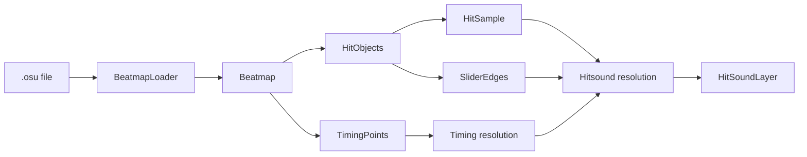

The main responsibilities are currently:

- `BeatmapLoader` parses `.osu` text into project objects.
- `Beatmap` owns beatmap-level data and the rules used to resolve timing and hitsounds.
- `TimingPoint` stores timing, sample-set, sample-index, and volume information.
- `HitObject` stores hit-circle, slider, and spinner data.
- `HitSample` stores the sample information attached to a hit object.
- `SliderEdge` stores hitsound information for the head, repeats, and tail of a slider.
- `HitSoundLayer` represents one logical sound layer after inheritance and timing rules have been resolved.
- `SampleResolver` maps logical layers to physical beatmap samples or explicit missing/fallback outcomes.
- `AudioPlaybackEngine` owns the output device, timeline source, mixer, and transient audio-reader lifetimes, including finite looping sources.
- `LoopingWaveStream` repeats reads by rewinding a seekable `WaveStream`; it does not own or dispose the underlying reader.
- `HitSoundPlaybackService` dispatches discrete hitsound layers and resolves/queues continuous slider-body layers through `PlaySliderBody(...)`; the bounded prequeue path starts the body with its slider-head event.
- `TimedHitSoundEvent` stores an event time, `HitObject`, `HitSoundEventType`, and optional `EdgeIndex`.
- `TimedHitSoundPlaybackCursor` tracks discrete event progress and can reset its position after seeking.
- `HitCirclePlaybackCursor` separately tracks hit-circle event progress and can reset its position after seeking.

Parsing, logical resolution, physical sample lookup, event selection, and audio output remain separate:

```text
.osu text -> BeatmapLoader -> Beatmap
Beatmap -> HitSoundLayer -> SampleResolver -> SampleResolutionResult
Beatmap -> TimedHitSoundEvent -> HitSoundPlaybackService
HitSoundPlaybackService -> AudioPlaybackEngine (found local samples only)
```

`SampleResolutionResult` can indicate a required external fallback or a missing custom file. Neither outcome is treated as an available local audio path.

---

## Current Class Structure

The diagram below intentionally shows the most relevant properties and methods rather than every member in every class.

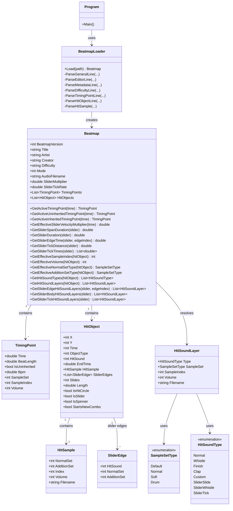

---

## Beatmap Loading Flow

`BeatmapLoader` reads the `.osu` file and builds the parsed model.

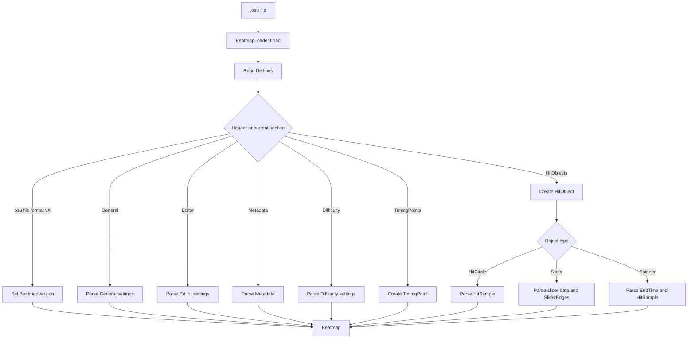

The loader is responsible for reading the file representation.

It does not decide which logical samples should ultimately play. That responsibility belongs to the resolution methods in `Beatmap`.

---

## Timing Resolution

Timing behavior is resolved at the time being queried.

The current timing methods are:

```text
GetActiveTimingPoint(double time)
GetActiveUninheritedTimingPoint(double time)
GetActiveInheritedTimingPoint(double time)
GetEffectiveSliderVelocityMultiplier(double time)
```

The distinction between timing-point types is important:

```text
uninherited timing point
    ↓
base beat length / BPM timing

inherited timing point
    ↓
slider velocity and sample-related inheritance
```

When no active inherited timing point exists, the effective slider velocity multiplier is:

```text
SV = 1.0
```

Otherwise, the current rule is:

```text
SV = 100 / -BeatLength
```

The methods use `double` time values because slider repeat and tail times may occur at fractional milliseconds.

---

## Hitsound Inheritance

Some `.osu` sample values use `0` to mean that the effective value must be inherited.

The current resolution flow is:

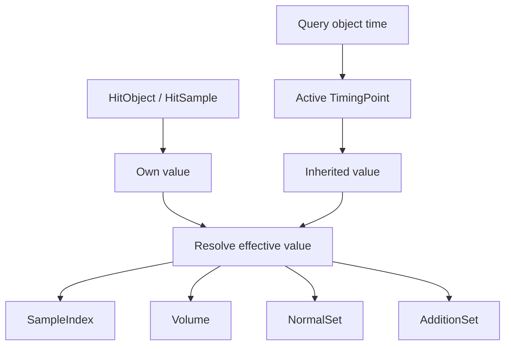

This resolution is used for:

```text
SampleIndex
Volume
NormalSet
AdditionSet
```

Sample-set inheritance can also fall back to the beatmap's default sample set when required.

---

## Sample Set Resolution

Numeric sample-set values from the `.osu` format are converted into `SampleSetType`.

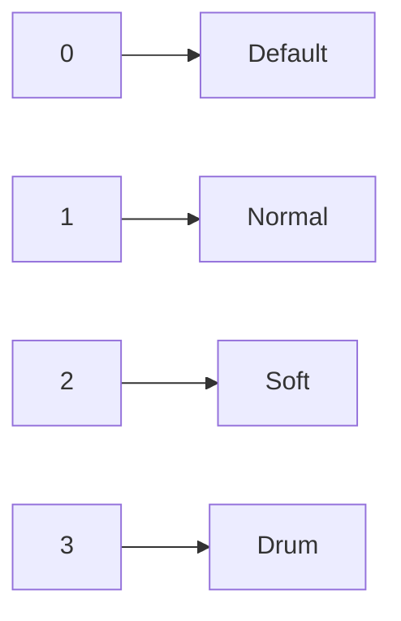

The effective sample-set methods combine inheritance with this conversion:

```text
GetEffectiveNormalSetType()
GetEffectiveAdditionSetType()
```

The logical representation uses `SampleSetType` instead of carrying the raw integer everywhere.

---

## Logical Hitsound Resolution

`HitSound` uses bit flags that may be combined.

The base object hitsounds are:

```text
Normal
Whistle
Finish
Clap
```

`GetHitSoundTypes()` interprets those flags.

`GetHitSoundLayers()` then resolves the information required by each sound layer:

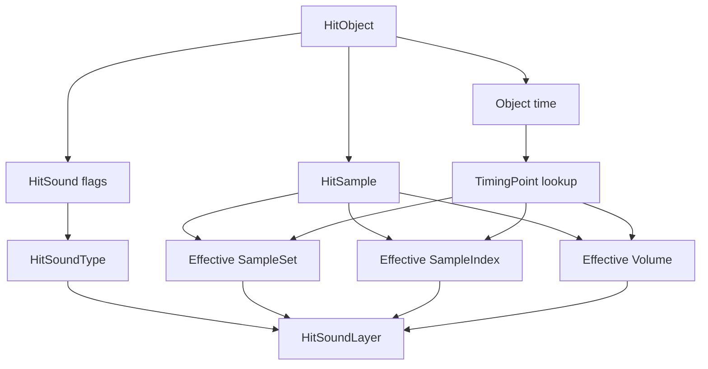

A `HitSoundLayer` describes the logical result:

```text
Type
SampleSet
SampleIndex
Volume
Filename
```

At this stage, the layer describes **what should sound logically**.

It does not yet guarantee that the corresponding physical sample file has been discovered or resolved from disk.

---

## Slider Timing

Slider timing is calculated in `Beatmap`.

### Span duration

Conceptually:

```text
spanDuration =
    slider.Length
    / (SliderMultiplier * 100 * SV)
    * activeUninheritedTimingPoint.BeatLength
```

`GetSliderSpanDuration()` requires:

- a valid positive `SliderMultiplier`
- an active uninherited timing point

Invalid states throw instead of returning valid-looking fallback values.

### Total duration

```text
sliderDuration =
    spanDuration * Slides
```

`Slides` represents the number of spans.

### Edge time

```text
edgeTime =
    slider.Time
    + spanDuration * edgeIndex
```

Edge indexes are interpreted as:

```text
0                 head
1 .. Slides - 1   repeats
Slides            tail
```

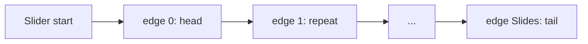

---

## Slider Edge Hitsounds

A slider may define different hitsound information for each edge.

The number of expected edges is:

```text
Slides + 1
```

`GetSliderEdgeHitSoundLayers()` first calculates the real time of the requested edge and then resolves that edge using the timing point active at that exact time.

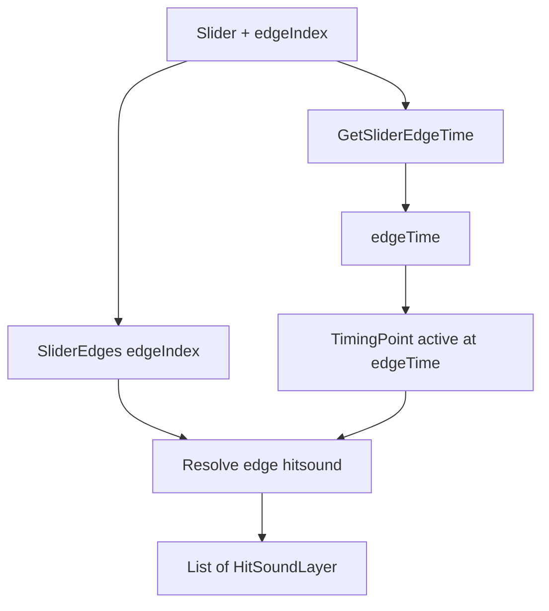

This means a repeat or tail may inherit a different `SampleSet`, `SampleIndex`, or `Volume` from the slider head if a relevant timing point changes during the slider.

---

## Continuous Slider Body Hitsounds

The slider body has continuous sounds that are separate from the discrete head, repeat, tail, and tick events.

`GetSliderBodyHitSoundLayers()` resolves:

```text
SliderSlide
SliderWhistle
```

`SliderSlide` is always part of the continuous slider body.

`SliderWhistle` is added when the slider's whistle hitsound is enabled.

`Finish` and `Clap` are not treated as continuous slider-body sounds.

`HitSoundPlaybackService.PlaySliderBody(...)` obtains the slider's total duration from `Beatmap.GetSliderDuration(slider)` and its logical body layers from `GetSliderBodyHitSoundLayers(slider)`. Each layer is resolved through `SampleResolver`; an available local file is passed to `AudioPlaybackEngine.AddLoopingAudioSource(...)` with that duration, the layer volume, and an optional relative delay. Missing custom samples and external fallbacks are returned as resolution outcomes, not sent to the mixer. Invalid slider state or duration is rejected.

`AddLoopingAudioSource(...)` uses `LoopingWaveStream`, normalized sample providers, volume, and an `OffsetSampleProvider` duration limit. The audio engine owns the playback readers; the looping wrapper does not dispose its underlying reader. In the bounded prequeue path, the body is started only when the slider-head event is included; repeat/tail events do not restart it.

`AddLoopingAudioSource(...)` now also accepts an optional `sourceOffsetMilliseconds` independent of the requested playback duration and prequeue delay. The engine converts elapsed source time to native source frames, calculates its position within the sample, and assigns a frame-aligned byte position to `LoopingWaveStream` before normalization. The default offset of zero preserves existing head-triggered behavior. This supports phase-aligned playback, but `PlaySliderBody(...)` does not yet calculate remaining slider duration or supply a source offset for in-slider starts/seeks.

---

## Slider Ticks

Slider ticks have their own timing and logical hitsound behavior.

### Tick distance

The base tick distance is:

```text
baseTickDistance =
    SliderMultiplier * 100 / SliderTickRate
```

For beatmap formats before version 8:

```text
tickDistance = baseTickDistance
```

For version 8 and newer:

```text
tickDistance =
    baseTickDistance * effectiveSliderVelocityMultiplier
```

This distinction is represented explicitly through `BeatmapVersion`.

### Tick times

`GetSliderTickTimes()` calculates tick times for every slider span.

The current flow is:

```text
calculate span duration
calculate tick distance
calculate slider velocity
calculate the 10 ms end exclusion distance

for each span
    determine whether the span is reversed
    calculate ticks along the path
    convert path progress to time progress
    return ticks in chronological order
```

Ticks at or too close to the span end are not generated.

For reversed spans, path progress is inverted and the generated values are reordered so the returned list remains chronological.

### Tick hitsound

`GetSliderTickHitSoundLayers()` produces one logical layer:

```text
SliderTick
```

The tick uses the slider's effective normal sample set, sample index, and volume.

It does not use the slider's addition sample set.

---

## Slider Audio Overview

The slider audio responsibilities are currently separated like this:

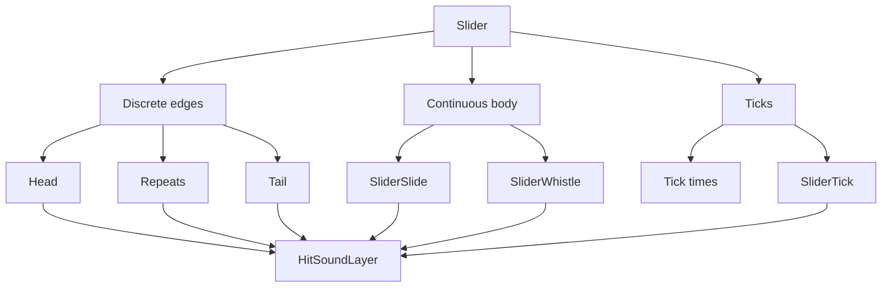

These responsibilities remain separate because they occur at different times and follow different osu! rules.

---

## Current Data Flow

The current overall flow is:

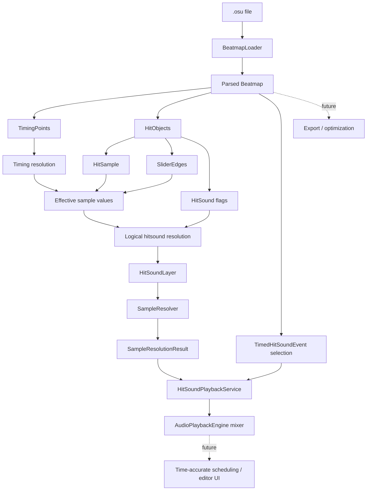

The audio path can dispatch selected discrete hitsounds immediately or prequeue discrete events together with slider-body playback triggered at included slider heads, before the mixer starts consuming audio. Prequeueing converts each absolute event time into a delay relative to one common interval start. The dashed branches indicate future active-playback scheduling, editor, export, and optimization functionality.

---

## Current Architectural Boundary

The current implementation reaches discrete hitsound playback, finite slider-body playback, and bounded prequeueing without implementing an editor timeline or active-playback time-accurate scheduler.

Implemented:

```text
.osu parsing -> logical HitSoundLayer -> SampleResolver
            -> SampleResolutionResult -> mixer input (if found)

Beatmap -> GetTimedHitSoundEventsInRange(...) -> timed discrete events
TimedHitSoundEvent -> PlayTimedHitSoundEvent(...) -> immediate dispatch or optional delay
TimedHitSoundPlaybackCursor -> AdvanceTo(...) / SeekTo(...) -> event selection progress
QueueTimedHitSoundEventsInRange(...) -> per-event relative delay -> prequeued mixer inputs
Slider-head event (EdgeIndex = 0) -> PlaySliderBody(...) -> finite looping mixer inputs
```

`AudioPlaybackEngine.AddAudioSource(...)` accepts an optional finite, non-negative `delayMilliseconds`; `OffsetSampleProvider` inserts initial silence in whole mixer frames. The mixer-input provider is also the key used to release its underlying reader when playback ends.

`QueueTimedHitSoundEventsInRange(...)` selects a chronological interval and computes `event.Time - startMilliseconds`. By default the interval is `(start, end]`, except that a start at zero includes events at zero. An optional `includeStart` includes an event at a positive start boundary, supporting post-seek reconstruction. When an included event is a slider head (`SliderEdge`, `EdgeIndex = 0`), the queue also calls `PlaySliderBody(...)` with the same delay and appends its resolution results to those of the head. Repeats and tails remain discrete-only events. Sources must be queued **before** the mixer advances through the interval; adding them after playback has progressed does not retrospectively align their timestamps. Head-triggered prequeueing does not reconstruct the remaining body when an interval begins midway through a slider.

Focused device tests confirmed pause/resume, pause-seek-requeue-play, and stop/requeue with a loaded timeline. These are integration checks, not permanent device-dependent suite tests. Current `Stop()` has a separate limitation when no timeline audio is loaded.

Not implemented yet: reconstructing an already-running slider body after an in-slider seek, accurate scheduling while audio is actively advancing, editor timeline/UI, deterministic export/reload/equivalence verification, and sample optimization.

---

## Tests

The project uses **xUnit** for automated testing.

Current checkpoint:

```text
674/674 tests passing (full suite, 2026-10-18)
```

The test suite currently covers:

```text
.osu parsing
beatmap settings and metadata
BeatmapVersion parsing
TimingPoint parsing
active timing-point resolution
active inherited/uninherited timing points
slider velocity resolution
SampleSetType conversion
SampleIndex inheritance
Volume inheritance
NormalSet inheritance
AdditionSet inheritance
beatmap default sample set
HitSound flag combinations
logical HitSoundLayer resolution
slider span duration
slider total duration
slider edge timing
slider edge hitsounds
continuous SliderSlide
continuous SliderWhistle
slider tick distance
pre-v8 / v8+ tick behavior
slider tick times
normal and reversed slider spans
SliderTick hitsound layers
invalid-state and boundary cases
physical sample filenames, banked and universal fallback, explicit custom-file outcomes
audio opening, normalization, mixer control, timeline seeking and playback volume
hit-circle, slider-edge, and slider-tick playback and interval selection
hit-circle cursor advancement and seeking
chronological TimedHitSoundEvent generation and playback dispatch
unified TimedHitSoundPlaybackCursor advancement/seek
relative delayed playback and mixer-reader cleanup
finite looping sample playback, duration cutoff, volume, delays, and reader cleanup
source-offset validation and frame-aligned loop phase with wraparound and finite cutoff
prequeued interval playback, inclusive boundaries, and overlapping hitsounds
shared-origin mixing of prequeued hitsounds with timeline audio
finite slider-body playback, head/body delay alignment, whistle mixing and missing-sample outcomes
```

The tests are located under:

```text
tests/
└── OsuHitsoundEditor.Tests/
    ├── BeatmapTests.cs
    ├── BeatmapLoaderTests.cs
    ├── TestOrganizationTests.cs
    ├── HitCirclePlaybackCursorTests.cs
    ├── TimedHitSoundPlaybackCursorTests.cs
    ├── HitSoundPlaybackServiceTests.cs
    ├── AudioPlaybackEngineTests.cs
    └── TestData/
        └── basic-beatmap.osu
```

Run the complete suite from the repository root with:

```bash
dotnet test
```

---

## Planned Development Stages

The following sections retain the original stage-level design goals. Physical sample lookup and substantial audio infrastructure are now implemented; remaining items are identified below. Refer to `docs/ROADMAP.md` for current task status.

### Physical Sample Resolution

Completed at the present lookup boundary: standard and slider sample filename resolution, banked/universal lookup, and explicit found/missing/fallback outcomes.

Deferred until needed: defining a stable logical `SampleId` and loading additional sample metadata.

### Audio Infrastructure

Implemented: NAudio decoding, output/mixer lifetime, timeline playback and seek, per-source volume, chronological event selection with `TimedHitSoundPlaybackCursor`, relative delayed sample playback, slider-body layers with finite looping, and bounded prequeueing before the mixer advances. Focused real-device checks covered pause/resume, seek/requeue, and stop/requeue.

Remaining: restoring slider-body playback state when seeking/starting inside a slider, accurate scheduling while playback is active, playback-controller coordination, editor-timeline integration, and runtime device-error recovery. NAudio is the selected external audio infrastructure.

### Desktop Editor and Timeline

Planned responsibilities:

```text
WPF application shell
open beatmap
timeline
playhead
zoom
waveform
hitsound events and tracks
selection
editing
snapping
```

### Export and Round-Trip Verification

The exporter must eventually support this deterministic cycle:

```text
parse
    ↓
logical representation
    ↓
export
    ↓
reload
    ↓
logical equivalence verification
```

The equivalence check must verify relevant properties such as:

```text
samples
multiplicity
timing
volume
overlaps
```

This stage must work before global sample optimization is introduced.

### Sample Optimization

The intended optimization priority is:

```text
1. Minimize redundant physical sample files.
2. Among equally minimal solutions, minimize effective SampleSet/SampleIndex combinations.
3. Preserve logical and sonic behavior.
```

A deterministic approach should be preferred first.

A global optimizer such as CP-SAT should only be considered if the problem later demonstrates that it actually requires one.

### Integration and Release Polish

Later work includes:

```text
error handling
larger beatmap testing
performance profiling
usability review
packaging
documentation
release preparation
```

---

## Sample Optimization Goal

One of the long-term goals of the project is to avoid unnecessary duplication of sample files.

For example:

```text
drum-hitnormal2.wav
drum-hitnormal3.wav
drum-hitnormal4.wav
```

may all contain the same logical audio sample.

The future optimization system should reason about the logical sample first and only then decide how that sound should be represented through osu!'s physical file/index system.

Conceptually:

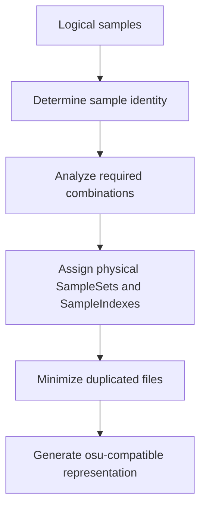

The optimizer must not assume that two samples are equivalent simply because they sound similar.

Sample equivalence must be based on an explicit rule, such as identical audio content or an equivalence declared by the system or user.

---

## Development Principles

### Logical and physical sample identity remain separate

The project keeps these concepts separate:

```text
Logical sample
    ↓
The actual sound that should be used

Physical osu! representation
    ↓
SampleSet
SampleIndex
HitSound
Filename
```

`SampleSet`, `SampleIndex`, and filename are encoding choices. They are not automatically the identity of the logical sound.

### Core domain logic remains inside the project

The following areas are primarily implemented by this project:

```text
.osu parsing
osu! timing behavior
logical hitsound representation
export
sample optimization
```

External libraries are acceptable for infrastructure such as audio playback or generic UI components when they provide a real benefit.

### Avoid premature abstractions

New interfaces, helper classes, resolver classes, or architectural layers should not be introduced only because they might be useful later.

A new abstraction should solve a real problem that already exists.

### Tests are the primary verification mechanism

Functional behavior should be verified with tests before moving to the next responsibility.

An AI suggestion, documentation statement, or architectural idea does not override behavior that has already been verified by the source code and tests.

### Official osu! behavior is verified rather than guessed

When format or gameplay behavior is uncertain, use:

```text
1. official osu! documentation
2. official osu! open-source implementation
```

instead of assuming how the format behaves.
